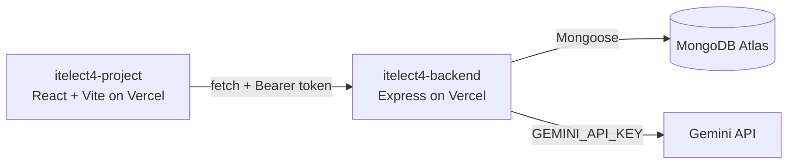

# Campus Lost and Found — itelect4-project

[](https://github.com/itsyogooey/itelect4-project-IT4B/actions/workflows/ci.yml)

A React and TypeScript web app for De La Salle Lipa students to report items they lost or found on campus.
Students register and log in, report an item at a campus location (picked from a dropdown that the API
serves), mark items as claimed or found, and use the **AI Report Helper**, which turns a quick, messy
description into a clean report draft using Google Gemini (through the backend — the browser never calls
Gemini and never sees the key).

- **Live site:** https://itelect4-project-it-4-b.vercel.app
- **Live API:** https://itelect4-backend-peach.vercel.app/api/health
- **Backend repo:** https://github.com/itsyogooey/itelect4-backend

## Architecture



## Pages

| Route | What it does | Login needed |
|---|---|---|
| `/login`, `/register` | Real accounts, checked by the API (JWT) | No |
| `/` | Dashboard: your items that are still lost, with Claim / Found | Yes |
| `/projects` | Items: report an item (Location dropdown), search your items | Yes |
| `/projects/:id` | One item, with its location name | Yes |
| `/ai-helper` | AI Report Helper: Gemini drafts a title, summary, category, clarity and tips | Yes |
| `/profile` | Your name and this session's item activity | Yes |

## How to run it locally

Needs Node 22.13 or newer, and the backend running (see the backend repo).

```bash
npm install
copy .env.example .env      # then set VITE_API_URL=http://localhost:4000
npm run dev                 # http://localhost:5173
```

## Tests

```bash
npm test          # Vitest: 3 test files, 6 tests
npm run build     # type-checks everything in src/ (tests included), then builds
```

- `src/components/CourseCard.test.tsx` — the item card shows the status, location and reward, and hides a zero reward
- `src/hooks/useToggle.test.ts` — the hook starts at its value and flips on every call
- `src/pages/LoginPage.test.tsx` — an invalid login form shows the schema's messages and sends no request

GitHub Actions runs `npm ci`, the type check, the tests and the build on every push (`.github/workflows/ci.yml`).

## TypeScript features

- Shared entity and API types in `src/types/index.ts`, derived with `Omit`, `Pick` and `Partial`
- Generic `ApiResponse<T>` and lookup helpers in `src/index.ts`
- Zod schemas for every form, with `z.infer` types
- Strict TypeScript configuration

## AI-use disclosure

AI tools were used while building this project:

- **Claude (Anthropic)** gave step-by-step guidance and drafted code for GT4–GT6, which I applied, ran and tested.
- **GitHub Copilot** (VS Code, Agent mode) ran the git and npm steps and applied the code changes.
- **Google Gemini** is part of the app itself: it powers the AI Report Helper page through the backend.

I reviewed and tested every change and can explain the code in this repository.
